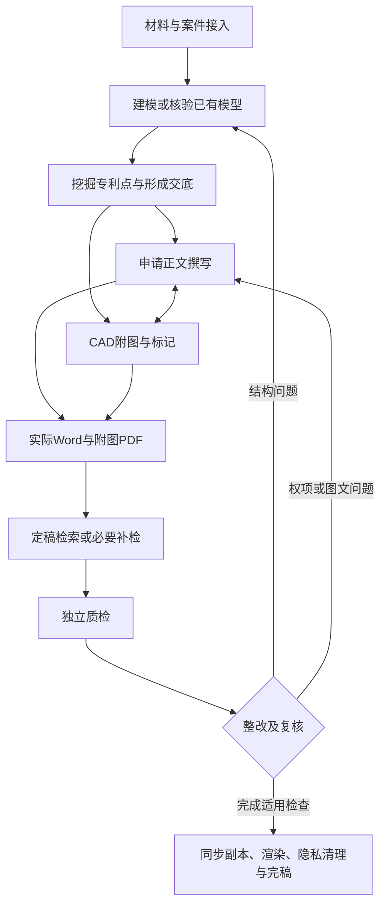

# 机械专利全流程技能包

**[⬇ 一键下载全部流程技能（ZIP）](https://github.com/yidaner4-ship-it/mechanical-patent-skill/raw/refs/heads/main/downloads/mechanical-patent-toolkit-20261123.zip)**

覆盖中国机械结构类发明、实用新型案件从建模、交底、申请撰写、附图、定稿检索、独立质检到清洁完稿的技能与公开辅助代码。解压上面的整包后，进入同时含 `install.py` 和 `skills/` 的目录，即可统一安装。

这是**技能文件整包下载**：Fusion、Python依赖、Office/PDF渲染程序，以及需要账号的检索服务，仍需由使用者在自己的电脑配置。下载包不包含原电脑的账号、密钥、虚拟环境、客户案卷、生产模型或个人模板。

## 下载和安装

1. 点击上方「一键下载全部流程技能」，解压 ZIP。
2. 在解压后含 `install.py` 的目录中打开终端，先查看安装计划：

   ```sh
   python3 install.py --dry-run
   ```

3. 确认目标位置后安装：

   ```sh
   python3 install.py
   ```

Windows 可将 `python3` 换成可用的 Python 3 命令（例如 `py -3`）。安装器只使用 Python 标准库，默认安装到 `$CODEX_HOME/skills`；未设置时使用当前用户的 `.codex/skills`。已有同名技能先备份到安装目录旁的 `skills-backups/`，不修改其他技能，也不复制或覆盖全局 `AGENTS.md`。

详见 [安装、依赖与恢复说明](INSTALL.md)。如需项目专用目录，可用 `--dest` 明确指定。`--only` 仅供已理解跨技能依赖的使用者选择部分根技能。

GitHub 的绿色 **Code → Download ZIP** 下载的是本仓库快照，包含兼容插件和 `downloads/` 中的整包；它与上方直接下载的全流程 ZIP 层级不同。需要全流程时，优先点击上方直链。

## 包内技能与流程

| 阶段 | 根技能／入口 | 用途 |
| --- | --- | --- |
| 案件接入、交底与申请 | `patent-disclosure-skill` | 总入口，内含 `patent-disclosure`、`patent-application`、可选 `patent-docket` 等子技能 |
| 建模／改模 | `fusion-production-modeling` | 逐件制造、真实安装接口、装拆关系、工况、干涉和STEP复验 |
| 专利附图 | `mechanical-patent-drawings` | 从可信几何取图、剖视／爆炸、标号、短S引线、图文同步与模板套版 |
| 定稿检索与评价 | `shensheng-patent-workbench` | 按当前权项组织实际检索、核验证据及记录新颖性／创造性评价 |
| 检索入口 | `patent-search`、`patseek-patent-search` | 公开检索辅助及外部服务适配，按实际配置选择 |
| 独立质检 | `shensheng-patent-qa`、`patent-draft-review` | 冻结实际稿件、独立审阅、逐处标号／逐根引线、整改和复核 |
| Word／PDF成品 | `documents`、`pdf` | 独立公开辅助版本，处理套版、真实修订、渲染、隐私清理及成品检查 |
| Excel检索报告 | `spreadsheets` | 独立公开辅助版本，处理候选表、公式与格式及隐私检查；基于公开的openpyxl依赖 |



已有有效模型或交底时从相应阶段接入；正文与附图联动。交底成稿也按适用范围质检。`patent-docket` 只在明确要求「交底申请一起做」「一条龙」「会稿」时调度，不强制所有案件进入案卷流程。

## 保留的撰写和附图要求

- 权1简洁且适度上位概括，保留解决核心问题的必要部件及配合；驱动、导向、紧固、方向和尺寸逐项判断必要性，具体后备结构按本案安排到从权或实施方式。
- 内容按权项顺序展开，各结构就近说明直接效果；实施方式从整机到局部，再以装配或工作过程串起关系。
- 附图来源和结构依据可追溯；一图一页、图体水平及垂直居中、图号放页脚，按具体实施方式首次实质引用顺序编号，用户锁定图号时记录例外。
- 短S及主要件箭头、字号、线宽等依包内现行规则核验；公开包只保留可公开的复现样例，不附带客户案件原图。脚本和像素检查不能代替真实落点、同源几何及最终图幅的逐根目视验收。
- 成稿和实质改稿接入适用的检索／补检、独立质检及最终清理。关键事实、图页或必要核读未完成时交付阶段成果并说明范围，不因列入问题单而宣称正式定稿。

## 公开版本与外部依赖

整包包含11个根技能目录。`documents`、`pdf`、`spreadsheets`以及部分审稿／检索适配入口采用**独立公开实现**，不包含相应官方缓存、第三方技能源码或商业客户端，也不声称与原环境组件完全相同。第三方开放组件的原许可证和必要署名随其文件保留；各组件的来源与分发范围以包内说明为准。

- 机械建模需要使用者可用的 Fusion 或其他 CAD 应用／接口；应用和商业许可不随包安装。
- Word／PDF渲染需要本地可用的 LibreOffice、Poppler 等程序，Python辅助库按所用子技能的要求安装。
- 连接检索服务需要下载者自己的服务连接、客户端和凭据。PatSeek公开版只提供外部客户端适配；未配置时明确不可用，不静默代搜或继承任何原账号费用授权。
- 基础文件安装器可跨平台使用。当前工作台的安全CLI依赖 macOS Keychain 和 POSIX `fcntl` 锁；Windows 应使用可用的服务连接或自行适配该CLI，不能据此认定商业检索在Windows下载后即可运行。

## 使用示例

```text
根据我提供的交底和有效模型，完成这件机械实用新型的五书。
沿用我的Word模板，独权保留必要结构及配合，正文与附图同步。
完成定稿检索、独立质检、整改复核和交付副本隐私清理；说明未完成项。
```

```text
交底和申请一起做。先核对本案有效材料与模型版本，
缺关键技术事实列清单，不编造；阶段成果与正式定稿分开说明。
```

## 原有插件的兼容入口

本仓库原有 `plugins/` 和市场目录继续保留。原有「机械专利撰写（含独立质检）」插件及独立质检插件可按原方式安装；它们的安装范围由各自插件清单决定，**不等同于安装上方全流程 ZIP 的全部根技能**。

以下为仓库现有插件的兼容安装方式，需客户端本身支持对应命令：

```sh
codex plugin marketplace add yidaner4-ship-it/mechanical-patent-skill --ref main
codex plugin add mechanical-patent-drafting@mechanical-patent-toolkit
```

已有该市场来源时，可按客户端支持的方式刷新：

```sh
codex plugin marketplace upgrade mechanical-patent-toolkit
```

旧插件的默认质检入口见 [随插件质检技能](https://github.com/yidaner4-ship-it/mechanical-patent-skill/blob/main/plugins/mechanical-patent-drafting/skills/shensheng-patent-qa/SKILL.md)。使用全流程技能时，建议从上方整包安装，按客户端能力避免同时启用重复命名的技能。仓库发布不会自动替其他电脑安装或更新技能；更新后按客户端提示重载或开启新对话。
